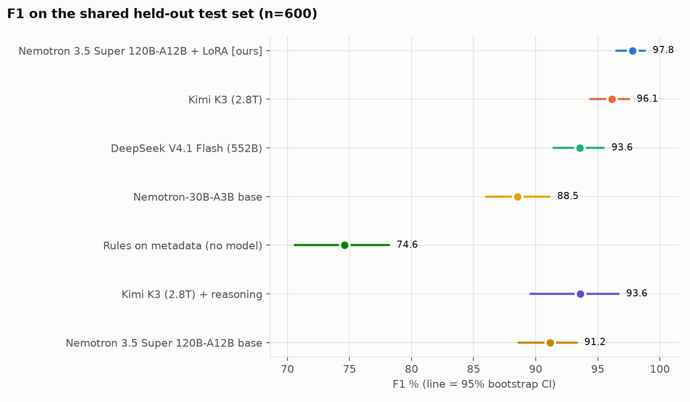
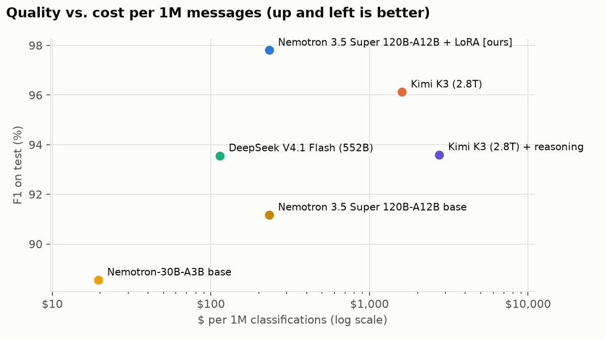
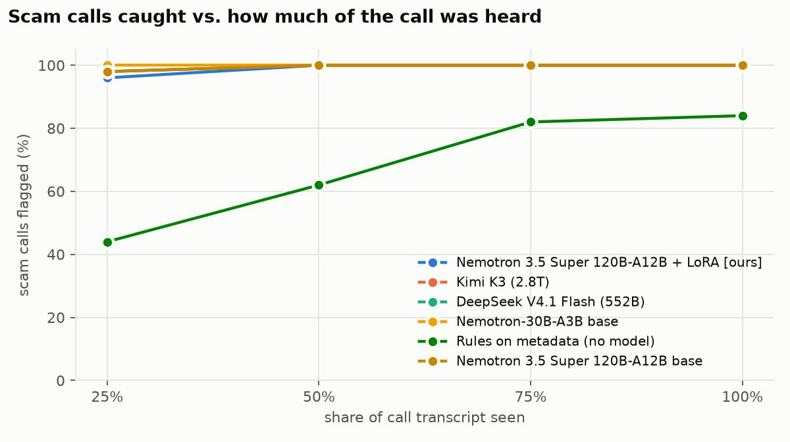
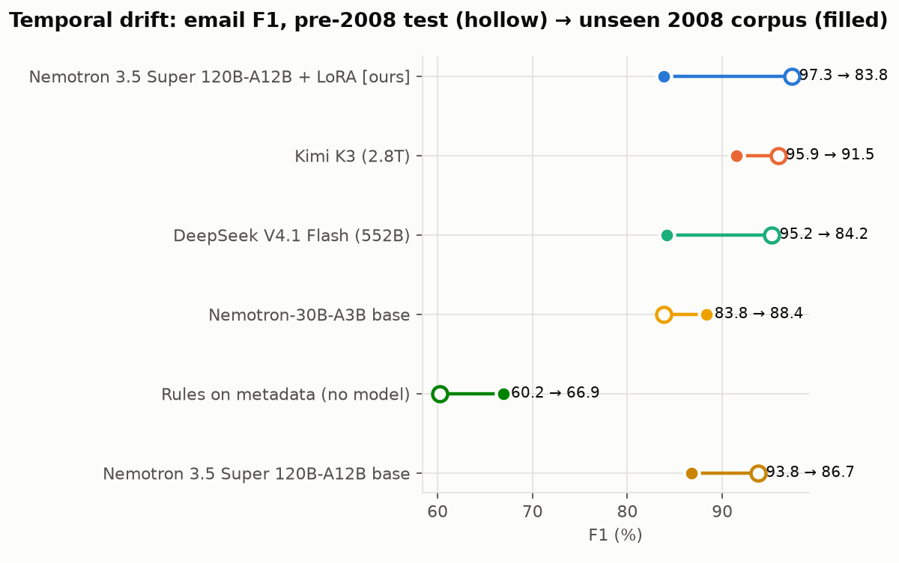

# PhishGuard: a fine-tuned Nemotron that screens scams across email, SMS, URLs and calls

**Fireworks: Deploy with Microsoft & NVIDIA** (HackerSquad, Nov 2 2026). Sponsor track: **NVIDIA Best-Use**, using an NVIDIA Nemotron 3.5 Super model LoRA-fine-tuned on Fireworks Serverless Training.

**Demo video (1:50):** [`docs/video/phishguard_2min.mp4`](docs/video/phishguard_2min.mp4) · **Slides:** [`docs/slides.pdf`](docs/slides.pdf) · **Guide:** [`docs/DEMO_GUIDE.md`](docs/DEMO_GUIDE.md) · **Presenter script:** [`docs/PRESENTER_SCRIPT.md`](docs/PRESENTER_SCRIPT.md)

> **Branch note.** This is the `round2` branch: the submission README with corrected checkpoint provenance, plus
> round-2 results produced **after** the submission deadline. The hackathon submission is the `main` branch; nothing
> in "Round 2" below is part of what was judged.

## Who it is for, and why it matters

Security and fraud teams at banks, telcos and enterprises screen a flood of messages on every channel: emails, SMS, links, and phone calls that are increasingly scripted (and now deepfaked). A frontier model is accurate, but at millions of messages a day it is too slow and too expensive to run on everything, and it means sending customer data to a third party. **PhishGuard** is an open model (NVIDIA Nemotron 3.5 Super VL, 120B total / 12B active parameters, about 23x smaller than the 2.8T frontier baseline), fine-tuned with LoRA on Fireworks. It labels each item `malicious` or `benign` from the content plus cheap metadata (sender/link/domain facts and timing cues), fast enough to act before the click or before the call ends.

## What we measured (same held-out cases for every system)

| | |
|---|---|
| **Task** | Binary: malicious (phishing, scam, fraud, unsolicited bulk spam) vs. benign, across 4 channels |
| **Our system** | `nvidia-nemotron-3p5-super-vl-120b-a12b-bf16` + LoRA (rank 16, lr 1e-4, batch 32, 1 epoch, 2,400 balanced examples), trained with Fireworks **Serverless Training** and evaluated by sampling the adapter in the training session (no deployment) |
| **Frontier baselines** | Kimi K3 (2.8T) and DeepSeek V4.1 Flash (552B) on Fireworks serverless, with the same prompt and metadata; plus Kimi K3 *with reasoning* on a 200-case subset as a ceiling check |
| **Other baselines** | the untuned Nemotron 3.5 Super (same session, same decoding), Nemotron Lightning 30B-A3B on serverless, a retrieval-augmented few-shot harness and router (cheaper tiers), and a zero-cost rules baseline over the metadata |
| **Test sets** | 600 in-distribution (150 per channel, balanced) · 200 emails from an unseen 2008 corpus (temporal drift) · 200 recent synthetic scams (ScamGuardBench, out-of-distribution) · 300 call prefixes (100 calls at 25/50/75%) · 20 real scam-baiting calls |
| **Metrics** | accuracy, precision, recall, F1, FPR with 95% bootstrap CIs; paired McNemar tests vs. each baseline; input/output tokens; $ per 1M messages; p50/p95 latency and share within a per-channel latency budget (where serving allows a latency measurement) |

## Results (submission)

_All numbers are measured, from [`results/summary.md`](results/summary.md) (regenerate with `make report`). Same 600 held-out cases for every system; 95% bootstrap CIs; paired McNemar tests._

**Checkpoint provenance:** every `ft-nemotron-super` result comes from the **epoch-1** checkpoint (`phish-ep1`). `results/_ft_state.json` lists only `base` and `ep1`, and every result file records `phish-ep1` as its `model_id`. The round-1 run was stopped during epoch 2, so no epoch-2 checkpoint from that run was ever evaluated. Round 2 retrained the same recipe and reproduced the result: 98.0% vs. 97.8%, paired p = 1.

| System | Size (total / active) | Accuracy % [95% CI] | F1 % | $ per 1M messages |
|---|---|---|---|---|
| **Nemotron 3.5 Super + LoRA, epoch 1 (ours)** | 120B / 12B | **97.8** [96.7, 99.0] | **97.8** | **$233** * |
| Kimi K3 (frontier baseline) | 2.8T | 96.2 [94.7, 97.5] | 96.1 | $1,600 |
| Kimi K3 + reasoning (200-case subset) | 2.8T | 93.5 [90.0, 96.5] | 93.6 | $2,751 |
| DeepSeek V4.1 Flash | 552B / 16B | 93.5 [91.5, 95.3] | 93.6 | $114 |
| Nemotron 3.5 Super, untuned (same decoding) | 120B / 12B | 90.7 [88.3, 92.8] | 91.2 | $233 * |
| Rules on metadata (no model) | — | 74.3 [70.7, 77.5] | 74.6 | $0 |

\* Cost for the fine-tuned model and the untuned Super is Fireworks'
published per-token **sampling** price for Nemotron 3.5 Super inside a
training session. It is not a production serving cost: the adapter was not
deployed, so its latency is not measured (n/a in `results/summary.md`) and
a deployed 120B model would not cost the same as sampling it. See
"Tradeoffs and limitations".

- **Quality, in distribution:** the fine-tuned Nemotron beats the frontier baseline on identical cases: **ΔF1 +1.7 pts [+0.2, +3.3], McNemar p = 0.041** (15 cases only ours got right vs. 5 only Kimi K3 got right). Fine-tuning adds **+6.6 F1 pts** over the same model untuned (p = 4e-9). Precision is 99.0% (1.0% false-positive rate vs. 2.7% for Kimi K3).
- **How to read that margin:** it is narrow and just significant, from a single seed (42), a single run, and a single checkpoint. Say "beats Kimi K3 on this 600-case set", not "beats frontier models" in general. A different split could change the sign.
- **Cost and size:** **6.9x cheaper per message than Kimi K3 on the sampling-price basis above**, from a model **23x smaller** (120B vs. 2.8T total parameters). The deployed-serving comparison is still to be measured.
- **Timing, early warning on calls:** after hearing **25%** of a call, ours flags **96%** of scams with **2%** false alarms, and 100% / 0% from the halfway point. Kimi K3 reaches 98% / 14% at 25% and 100% / 20% at halfway: it catches scams as early, but with 7–10x more false alarms.
- **Timing, drift (the honest tradeoff):** on an email corpus from a later year that was never trained on (2008 CEAS), ours falls to 83.8 F1 vs. 91.5 for Kimi K3. On recent synthetic scams (ScamGuardBench), it is 86.0% accuracy vs. 94.0%, with a 28% false-positive rate on hard legitimate look-alikes vs. 12% for Kimi. The fine-tune learned some corpus-specific patterns, and on OOD data it barely improves on its own base (85.5% → 86.0%). It should be refreshed with recent data, including hard negatives, or paired with a frontier fallback for out-of-distribution traffic.






Full per-channel, per-split, latency, and router/harness results are in
[`results/summary.md`](results/summary.md) and [`results/metrics.json`](results/metrics.json).

## Round 2 (post-deadline follow-up, not part of the submission)

Round 2 works through the next steps listed below. Checkpoints were selected **on dev data only**: the 200-case validation split plus two new dev slices built by `scripts/build_dev.py`, 200 later-corpus emails and 169 recent synthetic scams, disjoint from every frozen test file. Every epoch is still reported on the frozen tests. Details: [`results/round2/README.md`](results/round2/README.md) and [`results/round2/summary.md`](results/round2/summary.md). Cost: about $10.40, so about $18.70 of the $50 credit in total.

| Model (frozen tests) | Test acc (600) | vs Kimi K3, paired | Later corpus (200) | Recent synthetic (200) |
|---|---|---|---|---|
| **Text-only fine-tune, epoch 1** | **98.0%** | **ΔF1 +1.9 [+0.5, +3.3], p = 0.019** | 85.5% | **90.5%** |
| Metadata fine-tune, epoch 1 | 98.0% | n/a | 86.0% | 86.0% |
| Metadata fine-tune, epoch 2 | 97.3% | n/a | **91.5%** | 62.5% |
| Metadata fine-tune, epoch 3 (dev-selected) | 97.7% | ΔF1 +1.5 [+0.1, +3.0], p = 0.064 | 86.5% | 86.5% |

- **The submission result reproduces.** Same recipe, epoch 1: 98.0% vs. 97.8%, and the two differ on only 5 of the 600 cases (p = 1).
- **More epochs did not help.**
  - In-distribution accuracy stays flat across epochs.
  - Epoch 2 traded robustness for email drift: later-corpus accuracy rose to 91.5% while recent-synthetic accuracy collapsed to 62.5%. Validation alone would have missed this; the drift dev slices predicted it.
  - Epoch 3 won selection by 0.1 point of dev mean, which is noise. One epoch is the better buy.
- **Metadata is not needed once the model is fine-tuned.** Text-only matches the metadata model in distribution and on the later-corpus emails (p = 1). It is better on recent synthetic scams: 90.5% vs. 86.0%, with 9 cases only text-only got right and 0 the other way (McNemar p = 0.004). It also gives the strongest paired win over Kimi K3, and it halves the out-of-distribution gap to Kimi K3 (8 points down to 3.5). The later-corpus gap remains.

## How it works

```
HF datasets ──► build_data.py ──► unified records {channel, text, meta, timestamp, label}
                 (dedupe, balanced, domain-grouped URL split, CEAS-08 held out as 2008 test)
                        │
          features.py: links/domains, sender mismatch, domain age, urgency & deadline cues, send time
                        │
           prompt.py: one template, meta vs text-only variants, JSON-schema label output
              ┌─────────┴──────────┐
  Fireworks Serverless Training   Fireworks serverless inference
  LoRA on Nemotron 3.5 Super      Kimi K3 · DeepSeek V4.1 Flash · Nemotron Lightning
              └─────────┬──────────┘
        evaluate.py (async, resumable, hash-stamped) ──► report.py (CIs, McNemar, cost, latency, charts)
```

**Training setup** (Nemotron, the model this project is about):
- **Base:** `accounts/fireworks/models/nvidia-nemotron-3p5-super-vl-120b-a12b-bf16`.
- **Recipe:** LoRA rank 16, alpha 32, adapters on MLP, attention and unembedding layers (Fireworks SDK defaults, recorded in `results/round2/*/settings.json`). Constant learning rate 1e-4, batch size 32, 1 epoch over 2,400 balanced training examples (600 per channel), via `scripts/train_serverless.py`.
- **Loss:** masked to the assistant's output only, the JSON label of roughly 8 tokens per example, so the supervised signal per epoch is small.
- **Checkpoint:** the reported run used the epoch-1 checkpoint. Per-step training loss is logged in `results/round2/*/train_log.jsonl`, and the curves are in `results/round2/loss_curve.png`.

**Metadata and timing.** Each prompt carries a short Metadata block computed offline:
- **Links and domains:** link count, registered domains, shorteners, IP or punycode hosts, suspicious TLDs, brand-in-path tricks.
- **Sender:** sender vs. link domain mismatch.
- **URLs:** domain age plus page features.

**Timing** shows up three ways:
1. Urgency and deadline cues, and send-time/off-hours, as features.
2. A temporal-drift test on a corpus from a later year that was never trained on.
3. Latency budgets per channel (URL ≤ 0.5 s, SMS/call ≤ 1 s, email ≤ 2 s), plus an early-warning curve that shows how much of a call must be heard before the scam is flagged.

## Data

| Channel | Dataset (Hugging Face) | License | Notes |
|---|---|---|---|
| Email | `puyang2025/seven-phishing-email-datasets` | inherits sources | 7 corpora, all with both labels; positives are mostly spam. CEAS-08 (2008) is held out entirely as the temporal test; `receiver` and `dataset_name` are never shown to models |
| SMS | `ucirvine/sms_spam` | UCI SMS Spam Collection | spam vs. ham |
| URL / website | `pirocheto/phishing-url` | CC-BY-4.0 | split grouped by registered domain; `page_rank`, `google_index`, `web_traffic`, `statistical_report` excluded as near-label leaks |
| Calls | `BothBosu/scam-dialogue` | Apache-2.0 | synthetic (Llama-3-70B) transcripts, a proxy for real calls; plus 20 real calls from `BothBosu/youtube-scam-conversations` |
| OOD | `flowxai/scamguardbench` (English only) | Apache-2.0 per card | recent synthetic scams with urgency tactics and hard legitimate look-alikes |

Raw data is never committed. `make data` rebuilds the exact splits (seed 42); `data/manifest.json` records row counts, SHA256 hashes and dataset revisions. Note: `data/` is gitignored, so a fresh clone cannot verify hashes without running `make data` first. The round-2 dev slices are rebuilt with `uv run python scripts/build_dev.py`.

## Reproduce

```bash
uv sync                      # Python 3.12
cp .env.example .env         # add FIREWORKS_API_KEY (and FIREWORKS_ACCOUNT_ID for fine-tuning)
make data                    # frozen splits + fine-tuning JSONL (~20 s)
make rules                   # zero-cost baseline
make preflight               # one test call per model
make -j3 baselines           # serverless baselines (~$5)
uv run python scripts/build_dev.py                                                   # round-2 dev slices
uv run python scripts/train_serverless.py round2 --run meta-r16 --variant meta --epochs 1   # reported recipe (~$2.20 + ~$0.45 eval)
uv run python scripts/train_serverless.py round2 --run text-r16 --variant text --epochs 1   # text-only ablation
uv run python scripts/round2_report.py                                               # results/round2/summary.md
make report                  # submission report: results/summary.md, metrics.json, charts
```

A Serverless Training checkpoint can only be sampled while its training process, and therefore its session, is
still alive. The `round2` command evaluates inside the training process:
1. It trains each epoch and scores the new checkpoint on the dev slices.
2. It selects an epoch on dev only.
3. It then scores every epoch on the frozen test sets.

With `--epochs 1` it reproduces the reported epoch-1 numbers: 98.0% vs. 97.8% submitted, paired p = 1. The older
`train`-then-`eval` commands in `scripts/train_serverless.py` only work while the training process that made the
checkpoint is still running.

## Tradeoffs and limitations

- In-distribution scores are optimistic: train and test share corpora. The 2008 corpus and ScamGuardBench sets are the honest generalization checks and are reported separately, and they are where the fine-tuned model lags the frontier baseline.
- Email and SMS positives are mostly bulk spam, not targeted phishing; our label definition says so explicitly and every model sees the same definition.
- Call transcripts are synthetic and templated. The 20 real calls are a small spot check only (recall only, all scams).
- Latency: the fine-tuned model is sampled inside a Fireworks training session, not a production endpoint, so its latency is indicative only (reported as n/a); baselines run on shared serverless endpoints. The serving mode is listed on every row.
- Cost per 1M messages for the fine-tuned model uses Fireworks' published per-token sampling prices for Nemotron 3.5 Super, not a deployed-serving price.
- Managed fine-tuning was unavailable to our account during the event (dataset uploads disabled), so we trained through the Serverless Training API with the identical frozen data.
- Checkpoint selection: the submitted checkpoint (epoch 1) was not selected on validation. Round 2 adds dev-based selection and shows epoch 1 is as good as any later epoch on dev.
- Attribution: in round 2 the text-only (no-metadata) fine-tune matched the metadata one in distribution and beat it out of distribution, so the fine-tune's gain comes from text understanding, not the metadata block. The metadata ablation for the smaller Nemotron is incomplete.
- Content is truncated to 2,000 characters (~500 tokens) per item, so long emails can lose their payload.
- Out of scope: deepfake audio and video detection (no media fine-tuning on Fireworks in this window, and serverless audio was deprecated), and "fake API" scams (no public dataset).

## What is not yet done (next steps, in order)

1. ~~**Resolve and lock checkpoint provenance**~~ **Done (round 2).**
   - The submitted numbers are epoch 1, and that result reproduces.
   - LoRA alpha and targets, plus the loss curve, are now recorded.
2. **Export and deploy an adapter.** Adapters sampled in a training session disappear when the session ends. That happened to the round-1 session (`ts-00fc8e52f0b6485a89ab5f8779fb6df7`) and to the round-2 sessions. Next time, promote the chosen checkpoint before the session ends, deploy it, and re-measure latency and cost on real serving hardware.
3. **Sweep cheaply.** Partly done: epochs 1–3 at rank 16 and lr 1e-4, selected on dev. Still open: rank 8/16/32 × lr 5e-5/1e-4/2e-4, and a decaying learning rate with early stopping. The goal is to keep epoch 2's email-drift gain without its out-of-distribution collapse.
4. **Close the generalization gap.** The text-only ablation is done, and it narrowed the out-of-distribution gap. Still open: add recent phishing data and hard legitimate negatives, from sources other than the test corpora, to close the later-corpus gap (85.5% vs. 92.0%).
5. **Re-run on a second seed/split** before repeating the "beats Kimi" claim outside this 600-case set.

## Team, disclosures, sponsor track

- **Team:** _[FILL: names]_
- **Built during the event:** all code in this repository. No pre-existing project code or trained models. Round-2 code and results on this branch were added after the deadline.
- **AI assistance:** Claude Code helped write the data pipeline, evaluation harness, report generator and round-2 tooling. The team reviewed and ran everything and owns the results.
- **NVIDIA Best-Use track:** the submitted system *is* an NVIDIA Nemotron model (Nemotron 3.5 Super, 120B-A12B), LoRA-fine-tuned on Fireworks Serverless Training. Nemotron Lightning 30B-A3B also powers the cheapest tier of our router.
- **Datasets:** credited above under their licenses.
