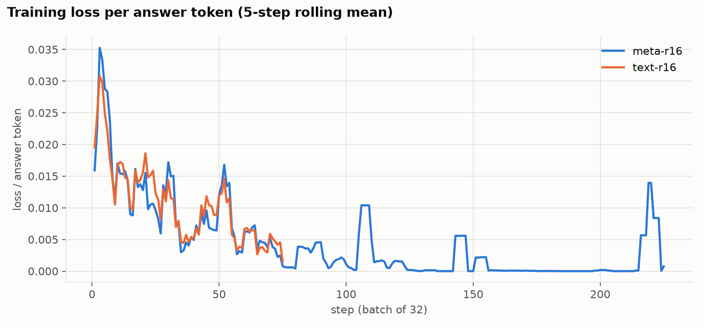

# Round 2 fine-tuning (post-deadline follow-up; not part of the hackathon submission)

_Checkpoints were selected on dev data only: the 200-case validation split plus two fresh dev slices (200 later-corpus emails, 169 recent synthetic scams) that are disjoint from every frozen test file. Every epoch is still reported on the frozen tests so the choice can be audited._

## Run `meta-r16`: meta prompt, LoRA rank 16 (alpha 32), lr 0.0001 (constant), batch 32, 3 epoch(s), seed 42

Training: 2400 examples, 944,394 tokens/epoch, est. $6.57 · session `ts-c918dbc831b2478b895915527946be92` · targets: MLP, attention, unembedding (SDK defaults)

| Checkpoint (epoch) | Dev: val | Dev: later corpus | Dev: recent synthetic | Dev mean | Test acc % [95% CI] | Test F1 % | FPR % | Errors | Later corpus acc % | Recent synthetic acc % |
|---|---|---|---|---|---|---|---|---|---|---|
| 1 | 98.0 | 85.5 | 83.4 | 89.0 | 98.0 [96.7, 99.0] | 98.0 | 1.3 | 12 | 86.0 | 86.0 |
| 2 | 97.5 | 91.0 | 58.0 | 82.2 | 97.3 [96.0, 98.7] | 97.4 | 3.3 | 16 | 91.5 | 62.5 |
| 3 **(selected)** | 97.0 | 84.5 | 85.8 | 89.1 | 97.7 [96.3, 98.8] | 97.6 | 0.3 | 14 | 86.5 | 86.5 |

## Run `text-r16`: text prompt, LoRA rank 16 (alpha 32), lr 0.0001 (constant), batch 32, 1 epoch(s), seed 42

Training: 2400 examples, 852,214 tokens/epoch, est. $1.98 · session `ts-9b57bdd8a16f4207bfd4ce15db1e9577` · targets: MLP, attention, unembedding (SDK defaults)

| Checkpoint (epoch) | Dev: val | Dev: later corpus | Dev: recent synthetic | Dev mean | Test acc % [95% CI] | Test F1 % | FPR % | Errors | Later corpus acc % | Recent synthetic acc % |
|---|---|---|---|---|---|---|---|---|---|---|
| 1 **(selected)** | 97.0 | 85.5 | 86.4 | 89.6 | 98.0 [96.8, 99.0] | 98.0 | 0.7 | 12 | 85.5 | 90.5 |

## Paired comparisons on the 600 frozen test cases (selected checkpoint)

| Run (selected epoch) | vs | n | ΔF1 pts [95% CI] | Only run right | Only other right | McNemar p |
|---|---|---|---|---|---|---|
| meta-r16 | Round 1: Nemotron Super + LoRA, ep1 (meta) | 600 | -0.2 [-1.0, +0.5] | 2 | 3 | 1 |
| meta-r16 | Nemotron Super, untuned | 600 | +6.5 [+4.1, +9.1] | 50 | 8 | 1.57e-08 |
| meta-r16 | Kimi K3 (frontier) | 600 | +1.5 [+0.1, +3.0] | 14 | 5 | 0.0636 |
| text-r16 | Round 1: Nemotron Super + LoRA, ep1 (meta) | 600 | +0.2 [-0.4, +0.8] | 2 | 1 | 1 |
| text-r16 | Nemotron Super, untuned | 600 | +6.8 [+4.5, +9.4] | 51 | 7 | 2.4e-09 |
| text-r16 | Kimi K3 (frontier) | 600 | +1.9 [+0.5, +3.3] | 15 | 4 | 0.0192 |

## Metadata ablation (epoch 1, same recipe)

| Test set | Text only (no metadata) | Meta, round 1 | Meta, round 2 run A |
|---|---|---|---|
| test | 98.0 | 97.8 | 98.0 |
| test_temporal | 85.5 | 85.5 | 86.0 |
| test_ood | 90.5 | 86.0 | 86.0 |

