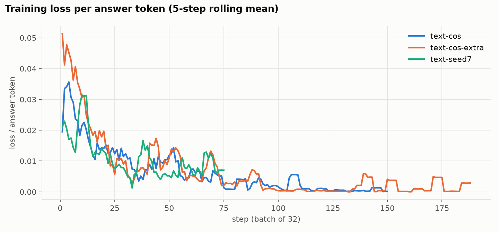

# Round 3 fine-tuning (post-deadline follow-up; not part of the hackathon submission)

_Checkpoints were selected on dev data only: the 200-case validation split plus two fresh dev slices (200 later-corpus emails, 169 recent synthetic scams) that are disjoint from every frozen test file. Every epoch is still reported on the frozen tests so the choice can be audited._

## Run `text-cos`: text prompt, LoRA rank 16 (alpha 32), lr 0.0001 (linear warmup 10% then cosine to 0.1x peak), batch 32, 2 epoch(s), seed 42

Training: 2400 examples, 852,214 tokens/epoch, est. $3.95 · session `ts-b3bf309720774627a3e30bfae6d17d82` · targets: MLP, attention, unembedding (SDK defaults)

| Checkpoint (epoch) | Dev: val | Dev: later corpus | Dev: recent synthetic | Dev mean | Test acc % [95% CI] | Test F1 % | FPR % | Errors | Later corpus acc % | Recent synthetic acc % |
|---|---|---|---|---|---|---|---|---|---|---|
| 0.5 | 96.5 | 84.5 | 84.0 | 88.3 | 98.2 [97.0, 99.2] | 98.2 | 1.3 | 11 | 85.5 | 87.5 |
| 1.0 **(selected)** | 97.0 | 85.0 | 84.6 | 88.9 | 98.0 [96.8, 99.0] | 98.0 | 1.0 | 12 | 84.5 | 86.5 |
| 1.5 | 97.5 | 86.0 | 82.8 | 88.8 | 98.3 [97.3, 99.2] | 98.3 | 1.3 | 10 | 85.0 | 83.5 |
| 2.0 | 97.0 | 85.0 | 79.3 | 87.1 | 98.5 [97.5, 99.5] | 98.5 | 1.7 | 9 | 85.0 | 81.0 |

## Run `text-cos-extra`: text prompt, LoRA rank 16 (alpha 32), lr 0.0001 (linear warmup 10% then cosine to 0.1x peak), batch 32, 2 epoch(s), seed 42, +600 extra rows

Training: 3000 examples, 1,021,961 tokens/epoch, est. $4.74 · session `ts-4b74921748bd4758b9935ecd22030f92` · targets: MLP, attention, unembedding (SDK defaults)

| Checkpoint (epoch) | Dev: val | Dev: later corpus | Dev: recent synthetic | Dev mean | Test acc % [95% CI] | Test F1 % | FPR % | Errors | Later corpus acc % | Recent synthetic acc % |
|---|---|---|---|---|---|---|---|---|---|---|
| 0.5 | 96.5 | 84.5 | 76.9 | 86.0 | 97.3 [96.2, 98.5] | 97.3 | 2.7 | 16 | 85.0 | 79.0 |
| 1.0 | 96.5 | 84.5 | 83.4 | 88.1 | 98.0 [96.8, 99.0] | 98.0 | 0.7 | 12 | 85.5 | 85.0 |
| 1.5 **(selected)** | 97.5 | 85.0 | 82.8 | 88.4 | 98.3 [97.2, 99.2] | 98.3 | 0.7 | 10 | 86.0 | 82.5 |
| 2.0 | 97.5 | 85.0 | 76.9 | 86.5 | 98.2 [97.0, 99.2] | 98.2 | 1.3 | 11 | 86.0 | 80.5 |

## Run `text-seed7`: text prompt, LoRA rank 16 (alpha 32), lr 0.0001 (constant), batch 32, 1 epoch(s), seed 7

Training: 2400 examples, 852,214 tokens/epoch, est. $1.98 · session `ts-132279b7813e470a90b8a70f8c92bbb3` · targets: MLP, attention, unembedding (SDK defaults)

| Checkpoint (epoch) | Dev: val | Dev: later corpus | Dev: recent synthetic | Dev mean | Test acc % [95% CI] | Test F1 % | FPR % | Errors | Later corpus acc % | Recent synthetic acc % |
|---|---|---|---|---|---|---|---|---|---|---|
| 1 **(selected)** | 96.0 | 86.0 | 91.1 | 91.0 | 97.7 [96.5, 98.8] | 97.6 | 0.7 | 14 | 85.5 | 92.5 |

## Paired comparisons on the 600 frozen test cases (selected checkpoint)

| Run (selected epoch) | vs | n | ΔF1 pts [95% CI] | Only run right | Only other right | McNemar p |
|---|---|---|---|---|---|---|
| text-cos | Round 1: Nemotron Super + LoRA, ep1 (meta) | 600 | +0.2 [-0.4, +0.7] | 2 | 1 | 1 |
| text-cos | Nemotron Super, untuned | 600 | +6.8 [+4.5, +9.1] | 50 | 6 | 1.02e-09 |
| text-cos | Kimi K3 (frontier) | 600 | +1.9 [+0.3, +3.6] | 16 | 5 | 0.0266 |
| text-cos | Round 2 best: text-only ep1 | 600 | +0.0 [-0.7, +0.7] | 2 | 2 | 1 |
| text-cos-extra | Round 1: Nemotron Super + LoRA, ep1 (meta) | 600 | +0.5 [+0.0, +1.1] | 3 | 0 | 0.25 |
| text-cos-extra | Nemotron Super, untuned | 600 | +7.1 [+5.1, +9.6] | 52 | 6 | 3.16e-10 |
| text-cos-extra | Kimi K3 (frontier) | 600 | +2.2 [+0.8, +3.9] | 16 | 3 | 0.00443 |
| text-cos-extra | Round 2 best: text-only ep1 | 600 | +0.3 [+0.0, +0.9] | 2 | 0 | 0.5 |
| text-seed7 | Round 1: Nemotron Super + LoRA, ep1 (meta) | 600 | -0.2 [-0.8, +0.3] | 1 | 2 | 1 |
| text-seed7 | Nemotron Super, untuned | 600 | +6.5 [+4.1, +9.0] | 51 | 9 | 3.09e-08 |
| text-seed7 | Kimi K3 (frontier) | 600 | +1.5 [-0.0, +3.2] | 15 | 6 | 0.0784 |
| text-seed7 | Round 2 best: text-only ep1 | 600 | -0.3 [-0.9, +0.0] | 0 | 2 | 0.5 |

