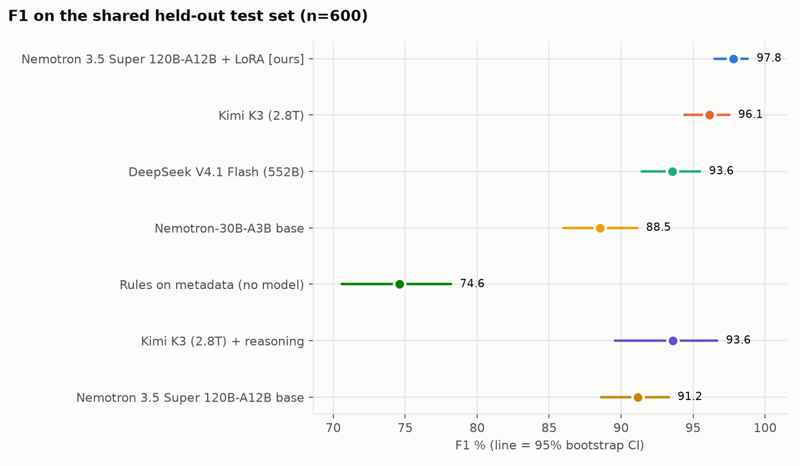
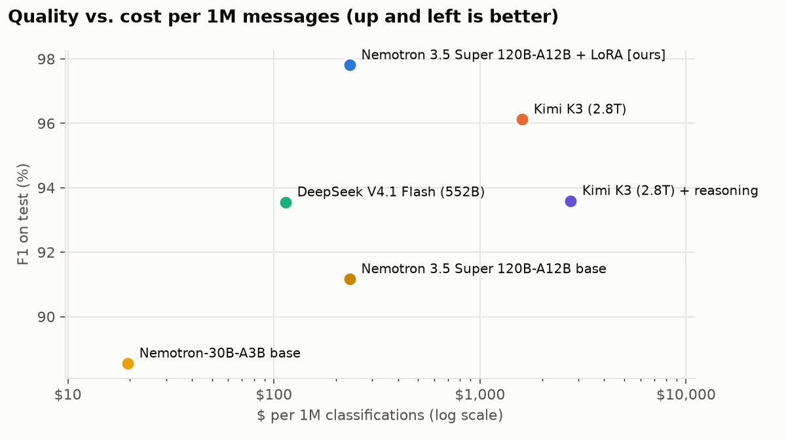
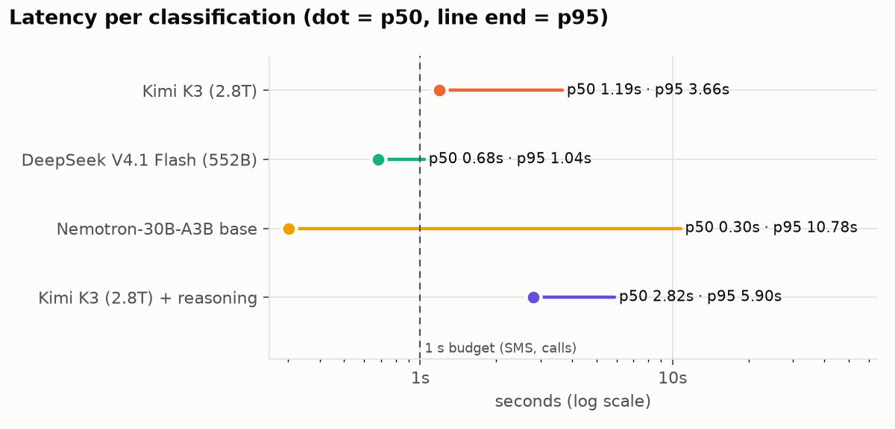
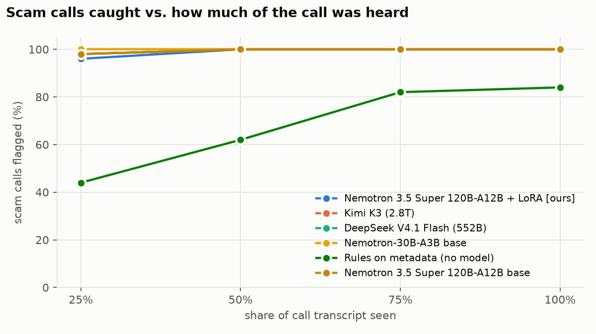
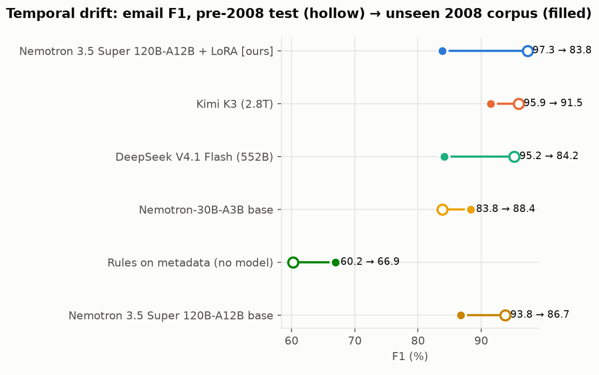

# Results

_Auto-generated by `make report` at 2026-11-02T22:26:48.970140+00:00. Every model was scored on the same frozen, hash-checked test files; 95% CIs are percentile bootstraps (1000 resamples)._

## Headline: shared held-out test set (600 cases: email, SMS, URL, call transcripts)

| Model | Size (total / active) | Serving | Accuracy % [95% CI] | F1 % [95% CI] | Precision % | Recall % | FPR % | Parse fail % | In / out tokens | $ per 1M msgs | Latency p50 / p95 (s) |
|---|---|---|---|---|---|---|---|---|---|---|---|
| Nemotron 3.5 Super 120B-A12B + LoRA [ours] | 120B / 12B | serverless-training | 97.8 [96.7, 99.0] | 97.8 [96.5, 98.8] | 99.0 | 96.7 | 1.0 | 0.0 | 388 / 8.0 | $232.87 | n/a |
| Kimi K3 (2.8T) | 2.81T | serverless | 96.2 [94.7, 97.5] | 96.1 [94.4, 97.5] | 97.3 | 95.0 | 2.7 | 0.0 | 464 / 14.0 | $1,599.58 | 1.19 / 3.66 |
| DeepSeek V4.1 Flash (552B) | 552B / 16B | serverless | 93.5 [91.5, 95.3] | 93.6 [91.4, 95.5] | 92.8 | 94.3 | 7.3 | 0.0 | 421 / 8.0 | $113.81 | 0.68 / 1.04 |
| Nemotron-30B-A3B base | 30B / 3B | serverless | 87.5 [84.7, 90.0] | 88.5 [86.0, 91.1] | 81.7 | 96.7 | 21.7 | 0.0 | 388 / 8.1 | $19.50 | 0.30 / 10.78 |
| Rules on metadata (no model) | n/a | local | 74.3 [70.7, 77.5] | 74.6 [70.6, 78.2] | 73.9 | 75.3 | 26.7 | 0.0 | 0 / 0.0 | $0.000 | 0.00 / 0.00 |
| Kimi K3 (2.8T) + reasoning | 2.81T | serverless | 93.5 [90.0, 96.5] | 93.6 [89.6, 96.7] | 92.2 | 95.0 | 8.0 | 0.0 | 444 / 94.6 | $2,750.58 | 2.82 / 5.90 |
| Nemotron-30B-A3B base + retrieval harness | 30B / 3B | serverless | 92.2 [90.0, 94.2] | 92.4 [90.0, 94.5] | 89.7 | 95.3 | 11.0 | 0.0 | 1301 / 8.2 | $62.13 | 0.31 / 2.56 |
| Router: Nemotron + Nemotron+harness agree, else Kimi K3 (9% escalated) | n/a | serverless | 93.5 [91.3, 95.3] | 93.7 [91.7, 95.5] | 91.2 | 96.3 | 9.3 | 0.0 | 1735 / 17.6 | $239.19 | 0.45 / 21.62 |
| Router: Nemotron + Nemotron+harness + DeepSeek agree, else Kimi K3 (15% escalated) | n/a | serverless | 96.0 [94.3, 97.5] | 96.0 [94.3, 97.5] | 95.7 | 96.3 | 4.3 | 0.0 | 2181 / 26.3 | $442.06 | 0.85 / 21.62 |
| Nemotron 3.5 Super 120B-A12B base | 120B / 12B | serverless-training | 90.7 [88.3, 92.8] | 91.2 [88.6, 93.3] | 86.5 | 96.3 | 15.0 | 0.0 | 388 / 8.0 | $232.87 | n/a |

## Ours (Nemotron 3.5 Super 120B-A12B + LoRA [ours]) vs. each baseline: paired on identical cases

| Baseline | n | ΔF1 (pts) [95% CI] | Only ours right | Only baseline right | McNemar exact p |
|---|---|---|---|---|---|
| Kimi K3 (2.8T) | 600 | +1.7 [+0.2, +3.3] | 15 | 5 | 0.0414 |
| DeepSeek V4.1 Flash (552B) | 600 | +4.3 [+2.2, +6.5] | 33 | 7 | 4.23e-05 |
| Nemotron-30B-A3B base | 600 | +9.3 [+6.5, +12.0] | 70 | 8 | 1.74e-13 |
| Rules on metadata (no model) | 600 | +23.2 [+19.2, +27.1] | 146 | 5 | 4.44e-37 |
| Kimi K3 (2.8T) + reasoning | 200 | +2.8 [-0.4, +6.4] | 9 | 3 | 0.146 |
| Nemotron-30B-A3B base + retrieval harness | 600 | +5.4 [+3.0, +7.6] | 42 | 8 | 1.16e-06 |
| Router: Nemotron + Nemotron+harness agree, else Kimi K3 (9% escalated) | 600 | +4.1 [+2.1, +6.1] | 34 | 8 | 6.88e-05 |
| Router: Nemotron + Nemotron+harness + DeepSeek agree, else Kimi K3 (15% escalated) | 600 | +1.8 [+0.3, +3.6] | 17 | 6 | 0.0347 |
| Nemotron 3.5 Super 120B-A12B base | 600 | +6.6 [+4.4, +9.0] | 50 | 7 | 4.24e-09 |

## F1 % by channel (test)

| Model | email | sms | url | voice |
|---|---|---|---|---|
| Nemotron 3.5 Super 120B-A12B + LoRA [ours] | 97.3 | 97.3 | 96.6 | 100.0 |
| Kimi K3 (2.8T) | 95.9 | 97.3 | 92.5 | 98.7 |
| DeepSeek V4.1 Flash (552B) | 95.2 | 96.0 | 93.6 | 89.8 |
| Nemotron-30B-A3B base | 83.8 | 93.0 | 88.3 | 89.3 |
| Rules on metadata (no model) | 60.2 | 77.5 | 74.3 | 88.9 |
| Kimi K3 (2.8T) + reasoning | 91.7 | 93.9 | 100.0 | 89.3 |
| Nemotron-30B-A3B base + retrieval harness | 90.8 | 94.8 | 88.6 | 95.5 |
| Router: Nemotron + Nemotron+harness agree, else Kimi K3 (9% escalated) | 92.7 | 95.4 | 90.4 | 96.2 |
| Router: Nemotron + Nemotron+harness + DeepSeek agree, else Kimi K3 (15% escalated) | 96.6 | 96.7 | 94.0 | 96.8 |
| Nemotron 3.5 Super 120B-A12B base | 93.8 | 94.2 | 92.4 | 85.2 |

## Timing

**Temporal drift (email):** trained/tested on pre-2008 corpora, then scored on the unseen 2008 CEAS corpus (n=200).

| Model / prompt | F1 % pre-2008 test | F1 % 2008 [95% CI] | Δ |
|---|---|---|---|
| Nemotron 3.5 Super 120B-A12B + LoRA [ours] / meta | 97.3 | 83.8 [77.3, 89.1] | -13.5 |
| Kimi K3 (2.8T) / meta | 95.9 | 91.5 [86.8, 95.4] | -4.4 |
| Kimi K3 (2.8T) / text | 93.7 | 86.5 [80.9, 91.5] | -7.2 |
| DeepSeek V4.1 Flash (552B) / meta | 95.2 | 84.2 [78.0, 89.1] | -11.1 |
| DeepSeek V4.1 Flash (552B) / text | 94.4 | 83.8 [77.3, 89.0] | -10.6 |
| Nemotron-30B-A3B base / meta | 83.8 | 88.4 [84.0, 92.4] | +4.5 |
| Rules on metadata (no model) / meta | 60.2 | 66.9 [60.0, 73.5] | +6.7 |
| Nemotron-30B-A3B base + retrieval harness / meta | 90.8 | 90.5 [86.0, 94.3] | -0.2 |
| Router: Nemotron + Nemotron+harness agree, else Kimi K3 (9% escalated) / meta | 92.7 | 93.5 [89.9, 96.7] | +0.8 |
| Router: Nemotron + Nemotron+harness + DeepSeek agree, else Kimi K3 (15% escalated) / meta | 96.6 | 90.1 [85.5, 94.0] | -6.5 |
| Nemotron 3.5 Super 120B-A12B base / meta | 93.8 | 86.7 [81.2, 91.2] | -7.1 |

**Early warning on calls:** scam calls flagged (recall) / benign calls falsely flagged (FPR) after hearing part of the call (100 test calls).

| Model | 25% | 50% | 75% | 100% |
|---|---|---|---|---|
| Nemotron 3.5 Super 120B-A12B + LoRA [ours] | 96 / 2 | 100 / 0 | 100 / 0 | 100 / 0 |
| Kimi K3 (2.8T) | 98 / 14 | 100 / 20 | 100 / 8 | 100 / 4 |
| DeepSeek V4.1 Flash (552B) | 98 / 28 | 100 / 40 | 100 / 40 | 100 / 28 |
| Nemotron-30B-A3B base | 100 / 34 | 100 / 28 | 100 / 32 | 100 / 28 |
| Rules on metadata (no model) | 44 / 0 | 62 / 0 | 82 / 8 | 84 / 10 |
| Nemotron 3.5 Super 120B-A12B base | 98 / 34 | 100 / 40 | 100 / 44 | 100 / 34 |

**Latency budgets** (share of requests answered within: url ≤ 0.5s, sms ≤ 1.0s, chat ≤ 1.0s, voice ≤ 1.0s, email ≤ 2.0s):

| Model | p50 (s) | p95 (s) | Within budget % | Server TTFT p50 (s) | Measured on |
|---|---|---|---|---|---|
| Kimi K3 (2.8T) | 1.19 | 3.66 | 36 | 0.764 | concurrency 1 (latency run) |
| DeepSeek V4.1 Flash (552B) | 0.68 | 1.04 | 80 | 0.485 | concurrency 1 (latency run) |
| Nemotron-30B-A3B base | 0.30 | 10.78 | 85 | 0.135 | eval run (concurrent) |
| Kimi K3 (2.8T) + reasoning | 2.82 | 5.90 | 10 | 0.943 | eval run (concurrent) |
| Nemotron-30B-A3B base + retrieval harness | 0.31 | 2.56 | 86 | 0.141 | eval run (concurrent) |
| Router: Nemotron + Nemotron+harness agree, else Kimi K3 (9% escalated) | 0.45 | 21.62 | 68 | n/a | eval run (concurrent) |
| Router: Nemotron + Nemotron+harness + DeepSeek agree, else Kimi K3 (15% escalated) | 0.85 | 21.62 | 52 | n/a | eval run (concurrent) |

## Metadata ablation (test F1 %)

| Model | With metadata | Text only | Δ |
|---|---|---|---|
| Kimi K3 (2.8T) | 96.1 | 95.9 | +0.2 |
| DeepSeek V4.1 Flash (552B) | 93.6 | 92.5 | +1.1 |
| Nemotron-30B-A3B base | 88.5 | 93.4 | -4.9 |

## Out-of-distribution: recent synthetic scams (ScamGuardBench, English)

| Model | n | Accuracy % [95% CI] | F1 % | Urgency-tactic subset acc % | Hard-negative FPR % |
|---|---|---|---|---|---|
| Nemotron 3.5 Super 120B-A12B + LoRA [ours] | 200 | 86.0 [81.0, 90.5] | 87.7 | 82.6 | 28.0 |
| Kimi K3 (2.8T) | 200 | 94.0 [90.5, 97.0] | 94.3 | 92.5 | 12.0 |
| DeepSeek V4.1 Flash (552B) | 200 | 90.0 [86.0, 94.0] | 90.9 | 87.6 | 20.0 |
| Nemotron-30B-A3B base | 200 | 62.5 [55.5, 69.0] | 72.7 | 53.4 | 75.0 |
| Rules on metadata (no model) | 200 | 70.5 [64.0, 76.5] | 76.9 | 64.6 | 57.0 |
| Nemotron-30B-A3B base + retrieval harness | 200 | 74.0 [68.5, 80.5] | 79.4 | 67.7 | 52.0 |
| Router: Nemotron + Nemotron+harness agree, else Kimi K3 (9% escalated) | 200 | 74.0 [68.0, 79.5] | 79.4 | 67.7 | 52.0 |
| Router: Nemotron + Nemotron+harness + DeepSeek agree, else Kimi K3 (15% escalated) | 200 | 91.5 [87.5, 95.0] | 92.2 | 89.4 | 17.0 |
| Nemotron 3.5 Super 120B-A12B base | 200 | 85.5 [80.5, 90.5] | 87.3 | 82.0 | 29.0 |

**Real scam-baiting calls (n=20, all scams; recall only):** Nemotron 3.5 Super 120B-A12B + LoRA [ours] 100%, Kimi K3 (2.8T) 100%, DeepSeek V4.1 Flash (552B) 100%, Nemotron-30B-A3B base 100%, Rules on metadata (no model) 50%, Nemotron-30B-A3B base + retrieval harness 100%, Router: Nemotron + Nemotron+harness agree, else Kimi K3 (9% escalated) 100%, Router: Nemotron + Nemotron+harness + DeepSeek agree, else Kimi K3 (15% escalated) 100%, Nemotron 3.5 Super 120B-A12B base 100%

## Charts

## Measurement notes

- Cost per 1M messages: serverless rows use Fireworks per-token prices from `config/models.yaml`; dedicated rows divide the GPU-hour price by measured throughput (`--mode throughput`), so they assume a fully used deployment.
- Latency: wall-clock from the client, including network. Serverless endpoints are shared; the fine-tuned model runs on a dedicated deployment, so the serving mode is listed on every row.
- Unparseable outputs count as wrong (a false alarm on benign items, a miss on malicious ones).
- `serverless-training` rows were sampled inside a Fireworks Serverless Training session (greedy decoding, no deployment): their cost uses published per-token sampling prices and their latency is indicative only.
